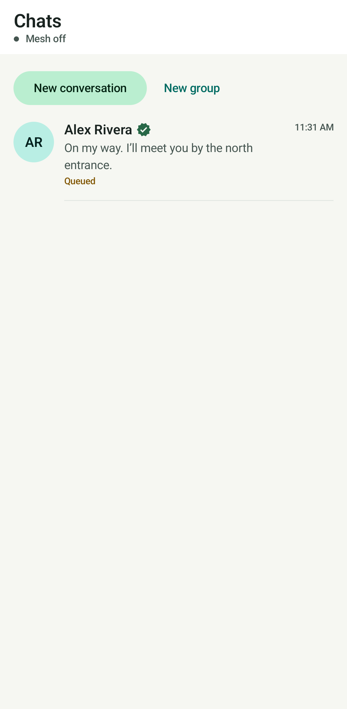
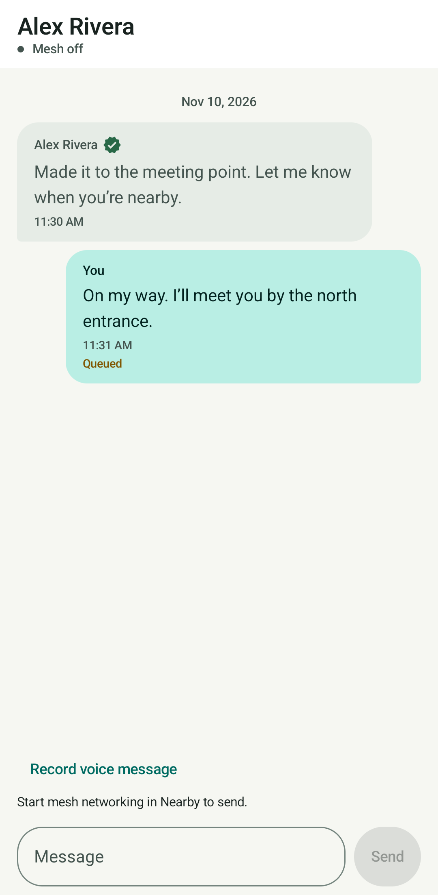
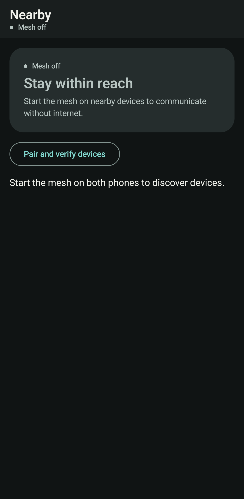

# MeshLink

MeshLink is an Android Kotlin project for encrypted text messaging across nearby devices without internet infrastructure. It combines Jetpack Compose, Bluetooth Low Energy (BLE), and AODV routing to explore practical offline mesh communication.

## What it does

- Discovers nearby BLE peers and forwards messages over multiple hops.
- Authenticates direct links with TLS and encrypts text end to end.
- Tracks destination acknowledgments, bounded retries, and delivery failures.
- Supports personal and group conversations, participant profiles, and a persistent encrypted message journal.
- Offers strictly on-device speech-to-text and a teal audio-reactive waveform.
- Provides connection/routing diagnostics and a foreground mesh service.

Android is the only supported platform. Voice-note recording, playback, and transfers are no longer supported. Historical iOS documentation and some retired voice code remain for reference, compatibility, and preservation of existing work.

## Offline mesh architecture

The Compose UI calls the application repository, which coordinates messages, the journal, security, and routing. BLE GATT carries fragmented frames between direct neighbors. TLS authenticates these links; endpoint encryption protects message contents across relays.

For multi-hop messaging, AODV discovers a route through participating peers. Intermediate phones forward packets toward the destination. All required relays must be running and reachable. Mesh range depends on device radios, surroundings, and connected participants; it is not unlimited.

A successful local BLE write only confirms progress on a direct link. **Delivery is confirmed by an authenticated destination acknowledgment**, not by a local write. Missing acknowledgments can lead to bounded retries and a visible failure.

## Security

Text envelopes use AES-GCM encryption, RSA-OAEP key wrapping, and ECDSA signatures. Direct neighbors use authenticated TLS. Replay checks, message lifetime checks, and encrypted local storage complement these protections. Fingerprint verification lets users explicitly verify a participant; unverified participants can still communicate.

This is a student project, not an independently audited security product or a guaranteed emergency-alert service. Relays and nearby observers can still learn network metadata. See [architecture notes](docs/ARCHITECTURE.md).

## Offline speech and waveform

Tap the microphone in the composer to dictate text, review it, then send it as a normal encrypted text message. The app uses `createOnDeviceSpeechRecognizer` on Android 12/API 31 or later and does not fall back to cloud recognition. Availability depends on the device recognizer and installed language model. Typing remains available on unsupported devices.

The teal waveform uses recognizer `onRmsChanged` callbacks. Some recognizers do not provide useful RMS callbacks, so visible loudness response is not guaranteed. Recognition error 11 releases the disconnected recognizer and lets the user retry; session ownership checks reject stale callbacks and lifecycle cleanup cancels listening when leaving the screen.

## Screenshots

These are existing UI validation captures, not promises of identical appearance on every device.

| Chats | Conversation | Nearby |
| --- | --- | --- |
|  |  |  |

## Requirements

- Android 7.0/API 24 or later; target and compile SDK 34.
- BLE central, peripheral, advertising, and GATT server capabilities on participating phones; validate on physical devices.
- Android 12/API 31 or later plus an available on-device recognizer and language model for speech input.
- JDK 17, Android SDK Platform 34, and the included Gradle 8.4 wrapper to build.

Use the same current build on all phones. Compatibility with older releases and iOS is not supported or verified.

## Build and install

Set `ANDROID_HOME` to your SDK directory, or configure an untracked `local.properties`, then run:

```sh
./gradlew testDebugUnitTest lintDebug assembleDebug compileDebugAndroidTestKotlin
adb install -r app/build/outputs/apk/debug/app-debug.apk
```

Add `--offline` when required dependencies are already cached. Windows users can use `gradlew.bat`. The APK is debug-signed; production signing and store distribution are not configured. Do not commit signing keys or local SDK configuration.

## Android permissions

- Bluetooth scan, connect, and advertise permissions on Android 12+.
- Legacy Bluetooth and location permissions for discovery on older Android versions.
- Microphone permission for optional speech input.
- Notification permission on Android 13+ for message and service notifications.
- Foreground service and connected-device service declarations for background mesh operation.

Microphone hardware is optional. Android background restrictions and vendor battery policies can affect mesh availability.

## Try two devices

1. Install the same build on two compatible phones and enable Bluetooth.
2. Set a recognizable name in **Settings → Edit my profile**.
3. On both phones, open **Nearby → Start mesh** and grant the requested permissions.
4. Wait for a peer to appear, then open its chat. Optionally compare fingerprints independently.
5. Type or dictate a short message, review it, and send.
6. Confirm receipt on the second phone and the delivered status on the sender. Repeat in the other direction.

For relay experiments, use a third phone and inspect routing diagnostics. Two phones alone cannot validate a multi-hop path.

## Limitations

- BLE capability, range, connection stability, and background behavior vary by device.
- Routes require participating peers; offline delivery is not guaranteed.
- Retries and queues are bounded. Group recipients may confirm independently.
- Speech and RMS availability vary by recognizer and language model.
- No supported voice-note or iOS messaging.
- Emulator/unit tests do not establish real radio behavior or recognizer availability.

## Testing and validation

See [developer setup and validation](docs/DEVELOPMENT.md), [offline speech checks](verification/OFFLINE_SPEECH.md), [disconnect recovery](verification/SPEECH_DISCONNECT.md), and [shared transport retesting](verification/SHARED_TRANSPORT_RETEST.md). Historical reports describe their own checkpoints, not necessarily the current build. Current preparation results and the proposed commit inventory are in [release preparation](verification/RELEASE_PREPARATION.md).

## Project structure

- `app/src/main/`: Android application, Compose UI, BLE transport, routing, security, and journal.
- `app/src/test/`: JVM regression tests, routing simulations, speech state and waveform-level tests.
- `app/src/androidTest/`: device and Compose instrumentation tests.
- `docs/`: current architecture/setup notes and archived README.
- `verification/`: validation records and real screenshots.
- `ios/`: historical Markdown records only; no active Apple build.

## Future improvements

Potential work includes broader physical-device testing, clearer offline language-model setup, longer-running mesh reliability experiments, and removal of remaining retired voice machinery after separating historical storage compatibility. These are future goals, not shipped capabilities.

## Copyright

Copyright © 2026 MeshLink contributors. All rights reserved.

MeshLink is a proprietary software project made publicly available for viewing and evaluation.

No license is granted to reproduce, modify, redistribute, sublicense, or commercially use the source code without prior written permission from the respective copyright holders.

Third-party components remain subject to their own licenses.
